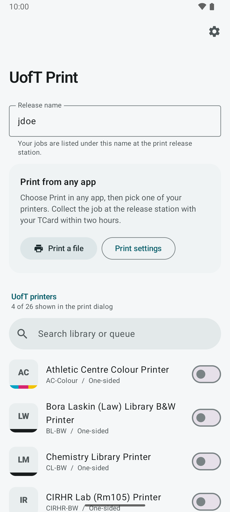
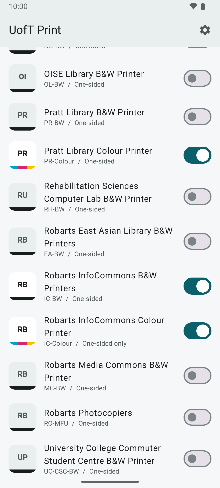
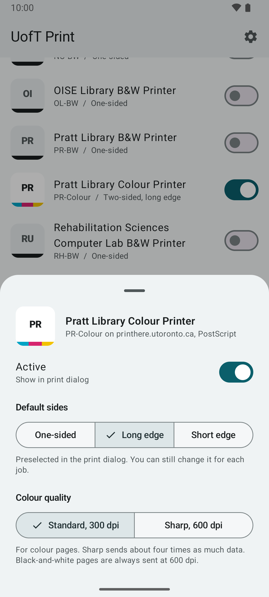
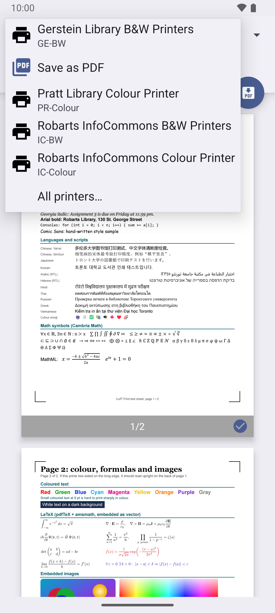

# UofT Print

English | [中文](README.zh-CN.md)

An Android print service for the University of Toronto's wireless printing system. All printers from [printhere.utoronto.ca](https://printhere.utoronto.ca/linuxprinting.html) are built in; switch on the ones you use and they appear in Android's own print dialog, so any app that can print can print to them. You can also add any other LPD printer.

<a href="https://www.buymeacoffee.com/e1even"></a>

<p>
  
  
  
  
</p>

## Install

Download the latest APK from [Releases](https://github.com/The-Eleven11/uoft-print/releases) and open it on your phone (Android 8.0 or later; allow installing from your browser or file manager when asked). Updates from Releases install over the previous version.

You can also [build it yourself](#build). A self-built copy is signed with your own key, so uninstall the release version before switching.

## Use

1. Open the app and set your **release name** (for example your UTORid). Jobs are listed under it at the Pharos release station.
2. Switch on the printers you use. Tap a printer to choose its default sides (one-sided, long edge, short edge).
3. Connect to the UofT network. Then in any app choose **Print**, pick a UofT printer and print. The first time, Android asks "Use UofT Print?"; tap OK.
4. Release the job at the printer with your TCard within two hours.

PDFs and images can also be printed through **Share → Print with UofT Print** or **Print a file** in the app. If the printers don't show up in the print dialog, turn on **UofT Print** under **Settings → Connected devices → Printing**.

## Build

Requires the Android SDK and JDK 17 (Gradle 8.11.1 does not run on JDK 25). In Android Studio: open the project, set **Settings → Build Tools → Gradle → Gradle JDK** to 17, then Run. From the command line, with `JAVA_HOME` pointing at JDK 17:

```bash
./gradlew :app:assembleDebug
```

The APK is written to `app/build/outputs/apk/debug/app-debug.apk`.

## Licence

[GPL-3.0](LICENSE).
