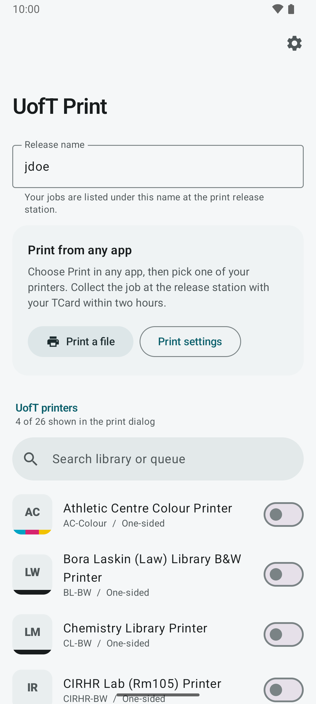
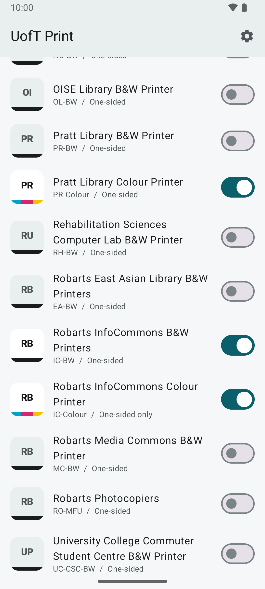
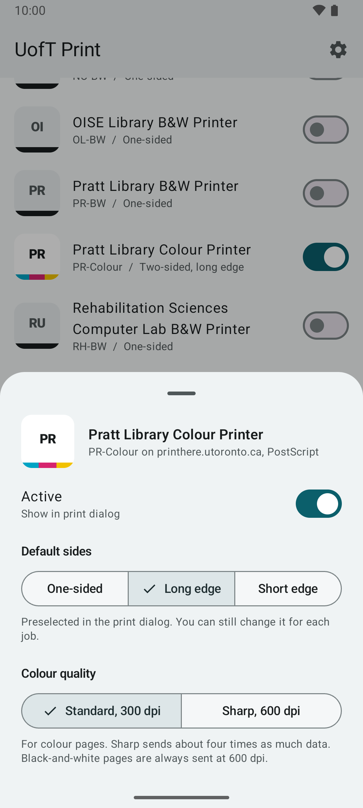
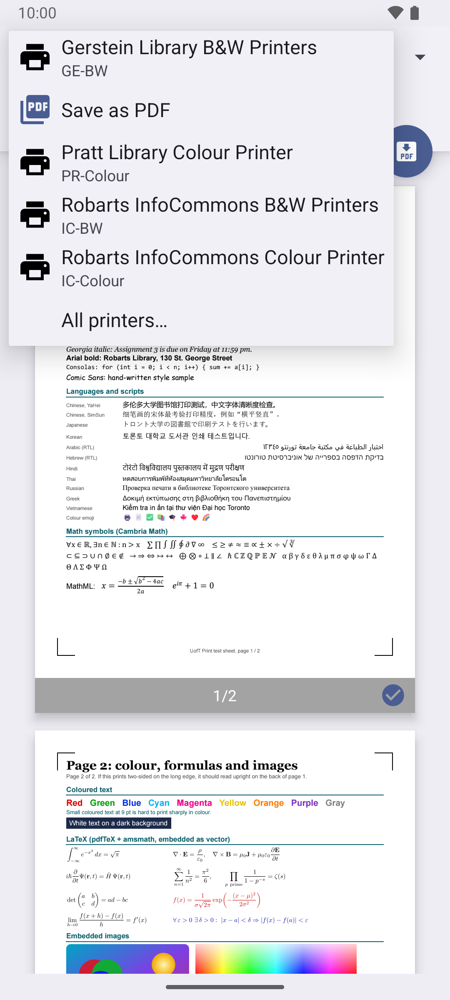

# UofT Print

[English](README.md) | 中文

Android 上的 LPD 打印服务。内置 U of T `printhere.utoronto.ca` 的所有打印机，启用后直接出现在系统打印对话框里（任何 App 的「打印」都能用），也可以添加任意 LPD 打印机。

<a href="https://www.buymeacoffee.com/e1even"></a>

<p>
  
  
  
  
</p>

## 安装

从 [Releases](https://github.com/The-Eleven11/uoft-print/releases) 下载最新的 APK，在手机上打开安装（需要 Android 8.0 及以上；如果提示，允许浏览器或文件管理器安装应用）。以后从 Releases 下载的新版本可以直接覆盖安装。

也可以按下文「构建」自己编译。自己编译的版本用的是你自己的签名，和 Releases 版之间切换需要先卸载。

## 使用

1. 打开 App，填写**取件名**（建议用 UTORid）。Pharos 取件终端上任务会显示在这个名字下。
2. 打开你要用的打印机；点打印机行可以设置默认单/双面和质量。
3. 连接 UofT 网络，然后在任意 App 里选「打印」→ 选 UofT 打印机 → 打印。第一次会弹「Use UofT Print?」，点 OK。
4. 两小时内到打印机旁刷 TCard 取件。

PDF / 图片也可以通过「分享 → 用 UofT Print 打印」或 App 里的「打印文件」打印。如果打印对话框里没有出现打印机，在「设置 → 已连接的设备 → 打印」中打开 UofT Print。

## 构建

需要 JDK 17（Gradle 8.11.1 不能运行在 JDK 25 上）。在 Android Studio 中把 Settings → Build Tools → Gradle → Gradle JDK 设为 JDK 17；命令行构建时设置 `JAVA_HOME`。

```bash
./gradlew :app:assembleDebug
```

生成的 APK 在 `app/build/outputs/apk/debug/app-debug.apk`，用 `adb install` 或拷到手机上安装。

## 许可证

GPL-3.0，见 [LICENSE](LICENSE)。
